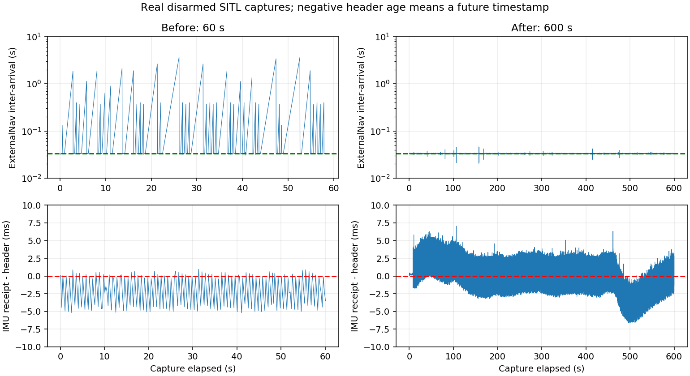

# SITL MAVLink 低频与 ExternalNav 停发修复

2026-10-09。已完成代码修复，并通过真实 SITL **600.076 秒无解锁在线验收**。IMU/速度从约4Hz提高到24.99Hz，ExternalNav从间歇停发恢复为约30Hz；验收期间18003条定位状态全部OK。这个结论限于本次地面数据流连续性，不代表飞行控制或EKF融合精度已经验收。

用户明确确认已落地未解锁，授权重启、重新标定和验收。已保留此前未提交修改、冻结保护、速度影子和协方差适配。未ARM、TAKEOFF、切GUIDED或启动任务；未发送PARAM_SET或写持久飞控参数。MAVProxy的REQUEST_DATA_STREAM会改变SR0运行时组速率，已限定在SITL并记录如下。

## 实测前后对比

修复前窗口60.104秒；修复后窗口600.076秒。频率按相邻样本首尾间隔计算，最大间隔为窗口内部相邻接收间隔；首尾静默另存summary，不隐藏边界。

| 项目 | 修复前 | 修复后 |
|---|---:|---:|
| IMU data频率 |3.99949Hz|24.99112Hz|
| IMU data最大间隔 |.25526s|.04857s|
| IMU data_raw频率 |3.99949Hz|24.99112Hz|
| IMU data_raw最大间隔 |.25698s|.05679s|
| local_position velocity频率 |3.99946Hz|24.99115Hz|
| velocity最大间隔 |.25763s|.05479s|
| accepted UWB频率 |24.99994Hz|25.00003Hz|
| world_pose频率 |8.97947Hz|29.99996Hz|
| ExternalNav odometry/out频率 |8.97951Hz|30.00002Hz|
| ExternalNav最大内部间隔 |3.63381s|.04634s|
| 定位状态 |1281条FC_IMU_STALE / 523条OK|18003条OK，0条FC_IMU_STALE|
| 有效IMU接收年龄最大值 |3.98551s|.07704s|
| MAVLink heartbeat频率 |.99981Hz|.99964Hz|

修复后ExternalNav首尾静默.03520/.04113秒；连接全程正常，600条state样本均armed=false、模式STABILIZE。新停发/恢复/回调缺失事件0条（不把订阅到的历史latched事件计入窗口）。



## 根因与证据

### 1. MAVProxy默认请求4Hz

实际链路是FC TCP5760→MAVProxy→UDP14552 MAVROS；QGC使用同一MAVProxy的UDP14550。修复前MAVProxy命令未指定--streamrate。安装的 `~/.local/lib/python3.8/site-packages/MAVProxy/mavproxy.py:239,1249` 默认4，987..1005行set_stream_rates每15秒请求REQUEST_DATA_STREAM ALL4。实测MAVLink ID30 ATTITUDE、27 RAW_IMU、32 LOCAL_POSITION_NED和ROS对应话题均约4Hz，排除了“FC已经高频但ROS插件降成4Hz”的解释。

修复后实际进程命令带 `--streamrate 25`，MAVProxy tlog记录窗口内40次来自255/230的ALL25请求，间隔约15秒。新鲜PARAM_REQUEST_READ/PARAM_VALUE核对确认SR0_RAW_SENS、EXTRA1、POSITION均25；SR1对应三项均0，SERIAL0_PROTOCOL=2。此前MAVROS param/get缓存的SR0=0不是实时FC读回，不能把缓存0当修改前的运行值。旧会话未单独fresh读取SR0，修改前4Hz依据实际流频率、默认值与启动命令交叉确认。

SR索引不是UDP端口编号：`GCS_Common.cpp:136..145` 按MAVLink协议实例绑定通道，`ArduCopter/Parameters.cpp:507` 起绑定SR0/SR1参数组；HAL_SITL UARTDriver使用首UART TCP5760。两个MAVProxy out共享SR0，不存在“14552因此改SR2”的映射。

本机MAVProxy `mavproxy.py:845..885` 会转发下游请求；`mavproxy_link.py:954` 的mavfwd_rate过滤位于相反的上游→下游方向，不能误判为请求防火墙。在线窗口还发现QGC255/190发送55次命令511，目标为HOME_POSITION242、1Hz；未观察到它请求IMU或LOCAL_POSITION_NED间隔。窗口内参数写入记录为空。不能据此排除窗口外或其他会话的GCS竞争。

### 2. 微量未来header被持续拒绝，才形成秒级有效数据空窗

4Hz自身约.25秒间隔，小于原有.40秒超时，因此它不是本次秒级停发的单独充分原因。基线241条IMU中187条在独立观察者接收时header微量超前，最大5.206ms；最大落后仅.952ms。估计器严格要求 `0<=header_age<=.40`，未来header被拒绝；持续到达不等于持续接受。有效IMU年龄最大3.9855秒，触发FC_IMU_STALE，world_pose和ExternalNav一起停止。UWB/Range最大年龄只有.0357/.0380秒，MAVROS保持连接。

1474条基线诊断带STALE_OR_FUTURE_HEADER，这是诊断样本数，不冒充拒包数。真实接收/header与publish时序离线回放中，控制其他输入为有效，旧规则超过一半检查失败，新规则失败0；这是时间逻辑回放，不是姿态/融合精度仿真。实际修复后header仍可微量超前（观察者最小年龄-6.640ms），但等待到时间到达后使用，定位不再间歇失效。

证据：`evidence/mavlink_baseline.summary.json`、`mavlink_stale_example.json`、`mavlink_after.summary.json`、`mavlink_online_analysis.json`、`mavlink_fresh_stream_params.json`、`mavlink_forwarding_tlog.json`。

## 代码与配置修改

- `tools/sitl.env` 显式SITL_MAVLINK_STREAMRATE默认25，两条入口 `start_indoor_sitl.sh` / `sitl_component.sh` 均通过sim_vehicle的mavproxy-args设置MAVProxy请求频率。正常目标20..50Hz；允许1..50支持诊断回滚，低于20有警告。配置验证在清理旧会话之前。没有另起与MAVProxy竞争的周期流速请求器。
- `world_estimator.py` 对合法且超前≤20ms的IMU只暂存一条；时间真正到达原header后才使用，保留原始接收时间及header。未来消息等待期间不参与定位；等待过期、时间倒退、大超前均失败关闭。**.40秒过期阈值未改**，接收年龄和header年龄仍双重检查，不重盖时间戳或重发陈旧位置。锁内获取now，避免锁等待后用旧时刻判断新鲜度。
- 新 `publication.py` 分别跟踪world与ExternalNav的STOPPED、REASON_CHANGED、RESUMED；事件记录停发起点、恢复时间/持续时间、原因、各传感器年龄、FC连接/解锁、健康状态和最后成功发布时间。健康正常但协方差适配阻止发送时单独标TRANSPORT_ADAPTER。回调缺失会在下一次回调记录TICK_GAP，缺失起点明确是估计，不能声称在无回调时有精确快照。
- `/indoor_nav/localization_diagnostics` 新增实际发送状态、最新IMU接收/header年龄、pending时刻、回调间隔/耗时；`/indoor_nav/publication_events` 发布同步事件。原诊断与速度/冻结功能保留。
- 新 `indoor_nav_mavlink_audit.py` 用墙钟同步记录ROS+原始MAVLink ID、header年龄、健康/状态、CPU及socket队列，生成频率/最大间隔/首尾静默。只订阅，可选调用只读param/get、vehicle_info_get，清楚标注缓存参数来源。
- 新 `indoor_nav_read_stream_params.py` 仅发送ID20 PARAM_REQUEST_READ，读新鲜PARAM_VALUE；不发送PARAM_SET、模式或流速改变。首个单次请求未收到响应，加入有界重试/latch后成功；首次丢失环节未抓包确认。
- 新 `summarize_mavlink_tlog.py` 离线核对流速请求者、间隔请求、参数写入、FC boot时间和ODOMETRY转发；`plot_mavlink_audit.py` 生成上图。

20ms是有界等待上限，不是允许未来姿态参与计算的负年龄阈值。它覆盖本轮实测毫秒级同步超前，但不处理大时钟偏差；超过边界仍会拒绝。未降低FC_LOST、UWB/Range过期、冻结、围栏或监督门禁，未开启UWB速度融合，EK3_SRC1_VELXY保持0，协方差适配保持false。实机YAML未修改。

## 协议与插件审计

本机Copter `GCS_Param.cpp:129..205` 支持REQUEST_DATA_STREAM并重新初始化组内间隔；一次SET_MESSAGE_INTERVAL可能被后续组请求覆盖。`GCS_Common.cpp:2911..2955,5300` 支持命令511，interval0恢复默认、-1停发。`GCS.h:516` persist_streamrates默认false，所以组请求修改内存速率而不持久写参数。`ArduCopter/GCS_Mavlink.cpp:495/523/532` 对应RAW_SENS→RAW_IMU、POSITION→LOCAL_POSITION_NED、EXTRA1→ATTITUDE。

MAVROS1.20.1官方 [imu.cpp](https://github.com/mavlink/mavros/blob/1.20.1/mavros/src/plugins/imu.cpp) 用姿态消息发布data，RAW_IMU等发布data_raw，收到ATTITUDE_QUATERNION后优先使用它；当前实际源ID30。官方 [local_position.cpp](https://github.com/mavlink/mavros/blob/1.20.1/mavros/src/plugins/local_position.cpp) 从LOCAL_POSITION_NED生成速度。官方 [sys_status.cpp](https://github.com/mavlink/mavros/blob/1.20.1/mavros/src/plugins/sys_status.cpp) 提供set_message_interval和set_stream_rate服务。conn heartbeat_rate是MAVROS发heartbeat频率，不是IMU流速配置。现有apm插件配置没有自动25Hz请求。

## 10分钟在线验收的其他结果

- 60个10秒检查点：arducopter累计CPU百分比2.9..3.2，MAVProxy13.9..15.8，MAVROS1.5..3.9；Gazebo实际进程最高约26。ps值是累计占比，不冒充每窗口瞬时CPU。
- UDP采样收发队列均0；TCP采样最大收244B、发907B，没有历史755703B持续积压。10秒采样不能排除采样点之间的瞬时排队。
- Gazebo sim/wall推进比.999969；FC ATTITUDE boot时间从46.219到646.059秒，LOCAL_POSITION_NED一致，无倒退；与约600秒wall窗口一致，未复现旧SITL停滞。
- 最大有效IMU接收年龄.07704秒、header年龄.07331秒；UWB接受年龄.03908秒、Range年龄.04107秒；估计器回调耗时最大2.155ms。未见支持timer/callback阻塞解释本轮停发的证据。
- 速度影子18003条均STATIONARY_OR_FROZEN_AMBIGUOUS，这是地面静止状态的正确保守标识，未发布可靠零速度假象或启用融合。
- MAVProxy向FC TCP转发18003条ODOMETRY，约29.99979Hz、最大间隔.04415秒。与ROS订阅边界略有数量差异；转发日志证明到发送socket这一段连续，不证明EKF采纳/融合。

完整采样保留在 `/tmp/mavlink_after.jsonl`。仓库压缩证据 `mavlink_after.jsonl.gz` 保留相关MAVLink ID与其他ROS话题，速度影子状态按1秒抽样，首行明确过滤规则；summary与统计基于完整采样。基线压缩记录用于自动时间回放测试。不能把10Hz下采样的Clock/Gazebo记录当原发布频率。

## 自动化测试与复现

基线50主测试+9核心测试PASS。最终**60主测试+9核心测试PASS，无skip**，catkin_make、compileall、shell语法、离线launch两种适配配置解析、git diff --check均PASS，记录 `evidence/mavlink_fix_validation.txt`。

新增覆盖微量未来等待且不重盖时间戳/刷新年龄、大超前/陈旧/pending过期拒绝、真实基线时序回放、停发原因变化/恢复、回调缺失、FC_LOST和适配门禁、流速默认与显式回滚配置。旧冻结回放、触发快照、坐标/杆臂、速度影子和协方差测试全部保留。

```bash
source /opt/ros/noetic/setup.bash
catkin_make
source devel/setup.bash
python3 -m unittest discover -s tests -v
python3 -m unittest discover -s src/indoor_nav/test -v
python3 -m compileall -q src/indoor_nav/scripts src/indoor_nav/src tools tests
bash -n tools/start_indoor_sitl.sh tools/sitl_component.sh tools/sitl.env
git diff --check
# 以下是只读采集，不启动飞行：
python3 tools/indoor_nav_mavlink_audit.py --duration 600 --read-params --output /tmp/nav_audit.jsonl
python3 tools/indoor_nav_read_stream_params.py
python3 tools/plot_mavlink_audit.py docs/evidence/mavlink_baseline.jsonl.gz docs/evidence/mavlink_after.jsonl.gz --output /tmp/nav_audit.png
```

## 启动问题、回滚与残余边界

首次临时执行会话启动后，组件随后退出，未计入验收；使用独立临时用户systemd服务后恢复稳定。一次服务启动明确报ROS_DISTRO unbound variable，已修复两个入口source ROS/devel时临时关闭nounset、随后恢复严格模式。当前 `indoor-nav-codex-sitl.service` 是临时Type=oneshot/RemainAfterExit=yes，不安装永久unit。验收完成后保留未解锁仿真。

需关闭时人工运行现有 `./tools/stop_indoor_sitl.sh`，或 `systemctl --user stop indoor-nav-codex-sitl.service` 清理本次服务；不要在飞行时使用。流速回滚在下一次获准重启时用 `SITL_MAVLINK_STREAMRATE=4 ./tools/start_indoor_sitl.sh`，会恢复已知低频，仅用于诊断。代码回滚按本轮列出的文件逐项审阅，保留前轮及用户修改，不用reset/clean。没有PARAM_SET或持久FC参数需要恢复。

本轮已证明频率和连续性改善，但未单独在线隔离两个修复各自的效果；未来header逻辑另有真实时序回放证据。没有新DataFlash日志，未直接确认EKF对每条ODOMETRY的采纳或创新；默认关闭的协方差适配、历史PErr100、动态坐标方向及位置/速度融合精度仍需专门验收。10分钟未复现旧停滞不等于其内部根因已解决。

**本次无解锁数据流验收通过，暂不建议直接进行航点飞行。** 应先完成PErr/融合质量与动态方向的无解锁验证，再由操作员单独批准飞行。
