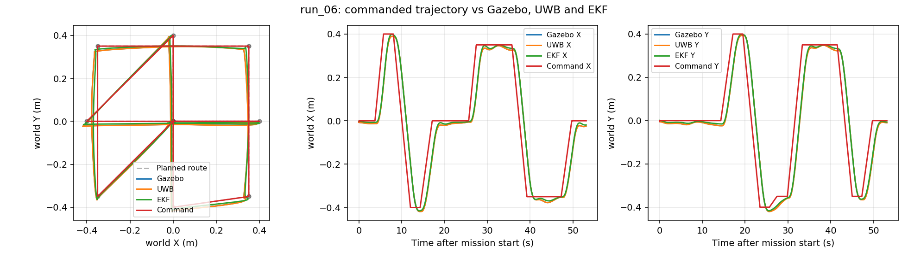

# SITL 自动飞行开发记录

日期：2026-10-09。本轮是少量闭环开发实验，不是可靠性或重复性验收。

## 本轮针对性复测：完整航点流程通过

本轮实际飞行2次：`run_05` 失败后完成有证据的修复，经操作员另行明确授权，`run_06` **通过起飞→悬停→10个航点→自动LAND→落地解除解锁**。累计历史实际起飞5次，另有一次未解锁尝试；不计算可靠性成功率，也未追加重复性飞行。

| 本轮记录 | 结果 | 证据 |
|---|---|---|
| `run_05` | 失败，正常降落 | +X、-X方向正确，真值进入±0.4 m目标容差；在第3点停留完成前，速度微小未来header触发ABORT。Y和矩形未执行 |
| `run_06` | **通过** | 航点任务53.13秒完成；全部10点真值进入0.12 m水平/0.08 m高度容差，mission返回COMPLETE，LAND后Gazebo落地且FC自动解除解锁 |

首个失败快照：`velocity_receipt_age_s=0.0002401`、`velocity_header_age_s=-0.00007343`，实际是新收到的测量时间戳约超前73微秒，不是速度断流或UWB冻结。新增监督器有界pending：只暂存最多超前20 ms的样本，到原header时刻后才可使用；保持原receipt/header及0.30秒过期检查，超过未来界限或pending过期继续拒绝。使用RLock将速度更新与watchdog取时/检查隔离，避免并发回调拿新消息与旧检查时刻比较。没有修改header、放宽过期阈值或发布旧位置。

修复后真实飞行中记录到3次pending等待；实际使用的速度header年龄始终为正，范围约0.00041～0.07962秒。73项主测试、9项核心测试PASS，新增覆盖等待/成熟、原始receipt不刷新、超界未来消息拒绝及pending过期。

两次均重新核实指定SITL二进制/PID、独立Master11321、loopback MAVROS14572、落地未解锁及相同已人工确认origin，通过正式ACK并等待真实READY。MAVLink25 Hz、ExternalNav配置30 Hz、位置协方差适配、围栏、冻结与FC_LOST门禁保持原设置。VELXY=0、影子速度不融合；没有实机连接或配置修改。批准及配置快照为 `retest_approval.json`、`retest_velocity_approval.json`。

### 最新实测（run_06）

统计窗口为TAKEOFF接受至MISSION_COMPLETE，约60.59秒；误差均为水平二维范数。

| 指标 | RMS / 最大 |
|---|---|
| EKF位置与Gazebo真值 | 0.00777 / 0.01346 m |
| UWB位置与Gazebo真值 | 0.00333 / 0.00911 m |
| EKF速度与Gazebo真值 | 0.01406 / 0.02008 m/s |
| UWB派生影子速度与Gazebo真值 | 0.00175 / 0.00549 m/s，917有效样本 |
| 真值对正在移动的位置目标跟踪误差 | **0.1432 / 0.2414 m**，不能与上述定位误差混为一谈 |

全部10个真值航点进入容差的任务相对时间约为0.50、6.36、12.51、17.73、23.89、28.07、33.95、39.70、45.45、50.35秒。最终COMPLETE证明任务节点完成其稳定/停留要求，53.13秒后结束航线。实际运动没有轴交换或符号反转；局部转弯及斜坡位置目标存在跟踪滞后，下一轮可针对控制响应改善，当前未调控制器或扩大围栏。

VISP.PErr全程0.20 m，原100未复现；XKF3 IPN/IPE在两核均量化为0.00 m（日志分辨率0.01 m，不是连续创新严格为零）。EKF_STATUS_REPORT有效1693条，flags均831；动态EKF与真实位置、速度一致支持ExternalNav实际参与位置估计，不再仅凭发布频率判定融合。

定位健康2035次均OK；无ABORT、POSSIBLE_UWB_FREEZE、FC_IMU_STALE、INVALID_VELOCITY_FRAME或FC_LOST。起降阶段Z_BELOW_FENCE为原有地面高度门禁，保持不变。

IMU实测24.987 Hz、最大间隔46.1 ms；world_pose30.000 Hz、最大间隔37.0 ms。ExternalNav实测29.671 Hz、最大间隔67.7 ms：适配周期重新读参时，有22次单帧停发，原因为ADAPTER_CHECK_STALE_OR_PENDING；未补发旧数据、未导致定位不健康，但不能描述为每帧严格连续30 Hz，留作后续优化项。心跳最大间隔205.6 ms，FC主循环400～401 Hz。



原始ROS bag、DataFlash快照、tlog、telemetry、events、summary及分析均在 `evidence/sitl_flight/run_05/`、`run_06/`；最新细分结果为 `analysis.json`、`waypoint_analysis.json`、`health_analysis.json`、`rates.json`。同一进程DataFlash含整个启动期，按VISP测量时间限定本次窗口。轨迹图可用 `evidence/sitl_flight/plot_target_comparison.py <run目录>` 离线重建。

**限制：** Mock仍是零注入噪声、零注入延迟；这是一次完整开发飞行成功，不代表真实UWB精度或可靠性验收。尚未执行真实噪声/延迟、故障注入、长时间或重复性测试。最终恢复地面初始姿态、STABILIZE和未解锁，安全确认已reset；本轮不再追加飞行。

## 历史失败与复测范围

| 记录 | 实际起飞 | 结果 |
|---|---|---|
| run_01 | 否 | 完整解锁检查拒绝主循环约304 Hz；改隔离Gazebo步长为1 ms后恢复400 Hz |
| run_02 | 第1次 | 起飞后1 Hz心跳触发1秒新鲜度门禁，LAND；改实际心跳5 Hz，原门禁不变 |
| run_03 | 第2次 | 首目标启动竞态导致SETPOINT_TIMEOUT；同步prime首目标，并使用原0.5秒首次目标期限 |
| run_04 | 第3次 | 测试工具误把锁存mission_state作为周期心跳，已修复；LAND正常 |
| run_05 | 第4次，本轮第1次 | X轴航点正确，微小未来速度header触发ABORT；本轮有界pending修复 |
| run_06 | 第5次，本轮第2次 | **完整航线通过，自动降落解除解锁** |

协方差适配前的run_02：VISP.PErr=100，EKF水平位置误差RMS0.258 m；最新run_06为PErr=0.20 m、误差RMS0.00777 m。不是同一完整轨迹单变量对照，不能解释成可靠性统计。上一轮详细记录保存在 [历史备注](evidence/sitl_flight/previous_stage_notes.md)，其“尚未完成”描述仅适用于上一轮。

## 复现与回滚

使用已有工具 `tools/sitl_flight_instance.sh` 启动独立实例，显式设置 `SITL_FLIGHT_COVARIANCE_ADAPTER=true`，适配全局默认仍关闭。原EEPROM复制到隔离运行目录，不控制真实飞控。工具每次动作前核对实例身份，fly不自动伪造ACK或READY。

```bash
source /opt/ros/noetic/setup.bash
source devel/setup.bash
export ROS_MASTER_URI=http://127.0.0.1:11321
# 实例已启动时，按本次origin/落地/身份证据完成正式人工安全确认后：
rosservice call /indoor_nav/safety/acknowledge
python3 tools/indoor_nav_flight_test.py fly --output docs/evidence/sitl_flight/run_NEW
python3 tools/analyze_sitl_flight.py docs/evidence/sitl_flight/run_NEW
```

以上是后续获授权后的复现方式，不表示本轮还会自动飞行。详细启动及隔离规则见历史备注。当前无需重启，保持落地未解锁及人工确认门禁。

本轮代码修改仅涉及 `safety_supervisor.py` 的速度pending与取时同步、`tests/test_freeze_ros.py` 的对应回归测试；另更新报告和离线轨迹证据。回滚只撤销这些pending/锁改动，保留上一轮坐标转换、首次目标时序及所有未提交修改；会恢复已知微小未来时间戳误报，不建议用于飞行。无本轮飞控参数需要回滚，不执行git reset/clean。
