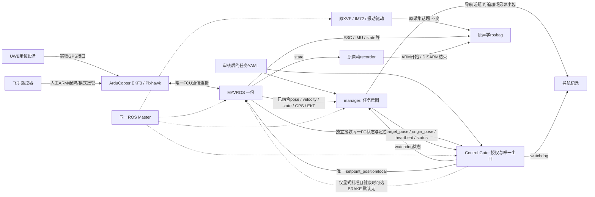

# V0代码与配置速查（待人工审阅）

2026-10-28，本地基线`dcf3919d6b14d5531e4044c892bc4572e8875ffd`。本轮只新增文档，不改生产代码。部署顺序见 [实机部署手册](REAL_AIRCRAFT_DEPLOYMENT.md)，未确认项见 [人工审阅清单](MANUAL_REVIEW_CHECKLIST.md)。

## 1. 核心目录树

以下来自当前实际目录，省略build/devel、二进制和大量历史证据；外部采集工作区不属于本仓库。

```text
indoor_nav_ws/
├── src/
│   ├── indoor_nav/
│   │   ├── package.xml / CMakeLists.txt / setup.py
│   │   ├── scripts/
│   │   │   ├── relative_mission_manager.py     V0任务意图
│   │   │   ├── v0_nav_health.py                V0唯一Control Gate
│   │   │   ├── mission_manager.py             旧ExternalNav任务
│   │   │   ├── safety_supervisor.py           旧安全监督
│   │   │   └── world_estimator.py             旧world_lab定位
│   │   ├── src/indoor_nav/
│   │   │   ├── v0.py                         V0纯Python契约/状态机
│   │   │   ├── core.py / external_nav.py       旧模式模块
│   │   │   └── navigation_velocity.py / velocity*.py / publication.py
│   │   ├── config/
│   │   │   ├── mission_v0.yaml                生产安全默认模板（5点）
│   │   │   ├── v0_sitl_gps.parm               隔离SITL参数，非实机模板
│   │   │   ├── mission_sitl_flight.yaml        旧ExternalNav飞行配置
│   │   │   └── mission.yaml / localization.yaml / safety*.yaml / ...
│   │   ├── launch/
│   │   │   ├── indoor_nav_v0.launch           仅V0两节点
│   │   │   ├── indoor_nav.launch              旧生产入口
│   │   │   └── indoor_nav_sitl.launch         旧仿真入口
│   │   └── test/test_core.py                  旧core回归
│   └── nlink_parser/                         现有构建依赖，V0不启动串口节点
├── tools/
│   ├── test_v0_relative_waypoints.py          离线schema / ROS只读smoke
│   ├── v0_sitl_instance.sh / v0_sitl_suite.py 隔离GPS SITL入口/冷启动批测
│   ├── v0_sitl_test.py / v0_sitl_stop.py       仅仿真飞行/身份限定停止
│   ├── v0_mock_acquisition.py                仅模拟采集负载
│   ├── v0_analyze_bag.py / v0_replay_receipt_time.py
│   ├── v0_archive_evidence.py / v0_archive_dynamic_evidence.py
│   └── start_indoor_sitl.sh / sitl_flight_instance.sh / ... 旧SITL工具
├── tests/test_v0*.py                         V0离线/ROS消息mock回归
└── docs/v0/
    ├── README.md / REAL_AIRCRAFT_SOP.md / SAFETY_AND_LIMITATIONS.md
    ├── FAST250_RECEIPT_TIME_REVIEW_20261028.md
    ├── FAST250_DYNAMIC_SITL_REPORT_20261028.md
    ├── SITL_STALL_REVIEW_20261028.md
    ├── REAL_AIRCRAFT_DEPLOYMENT.md            本轮新文档
    ├── CODE_AND_CONFIG_GUIDE.md               本轮新文档
    ├── MANUAL_REVIEW_CHECKLIST.md             本轮新文档
    └── evidence/                             历史与新证据，只读保护
```

## 2. 主要代码职责及定位

|文件 / 源码入口|职责|不是它的职责|
|---|---|---|
|`scripts/relative_mission_manager.py:25`|加载/校验YAML；记录源码/YAML/Git身份；读取FC身份及参数；调Mission状态机；发布任务意图和事件|不直接向MAVROS发布目标，不请求模式，不ARM/起降，不控制音频/rosbag|
|`scripts/relative_mission_manager.py:176`|只读vehicle_info_get、ParamGet，每约2秒更新限值快照；拒绝非4.5.7/不符参数|不是参数设置器；不支持按航段自动调速|
|`scripts/v0_nav_health.py:23`|沿用watchdog节点名的Control Gate，独立健康/ROS图检查、租约、唯一FC目标发布；可选受限BRAKE请求|不是第二定位源，也不是飞控/串口失效后的物理急停|
|`src/indoor_nav/v0.py:69`|严格schema，未知字段/重复键或ID、非法数值、非法策略/越界拒绝|不是可随意扩展字段的通用航点协议|
|`v0.py:171` / `v0.py:191`|四元数归一化、yaw与角度环绕；冻结任务轴的前/右/上→ENU转换|不手动再做ENU/NED转换，不依赖world_lab校准|
|`v0.py:200` / `v0.py:216`|4.5.7参数单位/范围核验；EKF_STATUS_REPORT解码和flags/ratio检查|不是通用固件自动兼容层|
|`v0.py:227`|Health：ROS接收时间+monotonic新鲜度、原始stamp诊断、GPS/EKF/跳变/倾斜/冻结一致性/悬停|消息一直来不代表物理定位真实；不检测所有同源自洽故障|
|`v0.py:406` / `v0.py:440`|ControlLease及Mission状态机：地面准备、活动任务授权、撤销、连续到达/DWELL/终态|不自动重新授权、不自动捕获新原点续飞|

V0运行时业务核心只导入`indoor_nav.v0`；表中旧`core.py`、ExternalNav/速度模块不是V0必经路径。保留它们用于旧成果和回归，不在本轮抽取、重构或删除。

### 2.1 状态与授权要点

`IDLE → WAIT_FOR_READY → CAPTURE_ORIGIN → HOLD_INITIAL → EXEC_WAYPOINT ↔ DWELL → FINISH_HOLD`；`stop`后STOPPED，异常ABORT_LATCHED。WAIT_FOR_READY是一次start调用内的检查，不是自动等待到健康后起飞；失败退IDLE，必须重新显式start。

**地面IDLE+DISARM+Gate无故障只准备内部observed_idle；实际owner租约在start成功、进入活动状态且ARM/GUIDED/健康后授予。** 没有独立enable/grant服务；`reset`只重建manager，Gate残留健康锁存可能仍要求地面重启两节点。详见部署手册第8、9节及`v0.py:413`、`relative_mission_manager.py:259`。

## 3. Launch及工具入口

|入口|用途 / 边界|
|---|---|
|`src/indoor_nav/launch/indoor_nav_v0.launch`|实机/仿真共用的导航入口，只启动`/v0_nav_manager`和`/v0_nav_watchdog`；不含MAVROS/Master/采集/注入|
|外部`rs485_driver_sound/all_sensors.launch`|实际文件必须由机载`rospack find`核查；onboard历史副本含MAVROS，另一个ros_sensor副本只有振动，不能互相代替|
|`tools/v0_sitl_instance.sh --sitl`|仅隔离SITL：ROS11421、Gazebo11455、FC TCP5760、FDM UDP9002/9003、MAVROS14672，独立runtime/EEPROM；内置GPS|
|`tools/v0_sitl_suite.py` / `v0_sitl_test.py`|仅显式仿真身份下自动ARM/起飞/航点/降落、冷启动与故障测试；**实机终端禁止运行**|
|`tools/start_indoor_sitl.sh` / `sitl_flight_instance.sh`|原ExternalNav/Gazebo流程，不是V0实机启动方法|
|`tools/test_v0_relative_waypoints.py`|`--config`离线解析并打印yaw=0目标；`--ros-smoke`接入已有Master做只读图快照，不是完整健康或飞行验收|

V0 launch的全部arg：

|arg|默认|修改生效方式 / 实机注意|
|---|---|---|
|`mission_file`|包内`config/mission_v0.yaml`|绝对路径指向审核后YAML；地面重启两节点|
|`enable_control`|false|只有true且dry_run=false才注册Gate FC publisher；地面重启两节点|
|`dry_run`|true|只读时无V0 FC publisher/模式请求；不能运行中rosparam热切换|
|`evidence_dir`|`$HOME/.ros/v0_nav`|两节点分别新建目录；地面启动时指定，不复用覆盖旧日志|
|`pose_topic`|`/mavros/local_position/pose`|同时remap两节点的pose输入；实机正常不改。它不是frame转换器，不可为通过检查换成伪造/非EKF源|

控制开启时唯一FC目标publisher必须为`/v0_nav_watchdog`；只读时为零个V0 FC publisher。`/v0_nav/target_pose`的publisher是manager，**不是飞控控制出口**。更改节点名/加namespace可能与Gate硬编码图检查冲突，不当作自由部署参数。

## 4. YAML速查：模板值、schema缺省与修改权限

**所有YAML在两个节点构造时各读取一次，无动态重载。** 下表所有更改都需要在地面DISARM、停止旧任务后**重启manager+Gate两节点**，确认两者YAML SHA一致；不允许仅改磁盘文件后继续旧飞行。

权限标记：**任务可改**＝经本轮任务审阅，在schema/已批准物理包络内编辑；**需复核**＝需要负责人重新核验实机安全，不等于现场随意调参；**固定**＝当前schema或实现限定，不提供改法。下表的“模板值”来自当前`mission_v0.yaml`，并非所有字段都可省略。

### 4.1 固定策略与航点

|字段|模板值 / 单位|说明及修改权限|
|---|---|---|
|`schema_version`|1|固定整数1，无省略缺省|
|`mission_id`|acoustic_relative_v0_001|任务可改；1–80位字母数字/`_.-`，每轮唯一；非空必填|
|`navigation.vehicle / source`|ArduCopter / fc_ekf_gps|vehicle固定；source还接受fc_ekf_fake_gps和fc_ekf_sitl_gps，但只是策略/来源声明，不切EKF、不注入GPS；实机保留fc_ekf_gps|
|`navigation.require_upstream_health`|false（也为schema缺省）|需复核；true额外要求`/v0_nav/upstream_healthy` Bool及1秒新鲜度，无真实健康源不能启用或常量true糊弄|
|`reference.*`|pose_at_mission_start / yaw_at_mission_start / forward_right_up|固定；唯一P0/yaw0，不使用上一航点或转向后的机头轴|
|`start_policy.*`|require_operator_start / require_manual_takeoff / require_stable_hover / require_guided_mode均true；auto_arm / auto_takeoff / auto_land均false|全为固定必填布尔策略；更改为自动行为会被拒绝|
|`waypoints[]`|当前5点，初始停留→前0.3→右0.3→后→回起点|任务可改；1–100点，逐点必须含id/x/y/z/hold_s，无额外yaw字段|
|`waypoints[].id`|唯一字符串|任务可改；同mission_id字符约束，禁止重复|
|`x / y / z`|m|任务可改；前/右/上相对P0。每轴schema -2..2 m且须满足径向/竖直边界；语法范围不是批准实飞范围|
|`hold_s`|当前3/4/4/4/5 s|任务可改；0–60秒，到达稳定后停留；初次单点需另审独立配置|
|`finish.action`|hold_and_wait_pilot|固定；FINISH_HOLD持续最后目标和健康检查，不自动LAND/DISARM|

换算公式：`xt=x0+f*cos(yaw0)+r*sin(yaw0)`，`yt=y0+f*sin(yaw0)-r*cos(yaw0)`，`zt=z0+u`。所有点使用同一原点、同一初始yaw；MAVROS负责ENU/NED转换。`z=0`不是AGL=0。

### 4.2 控制、速度和到达

|字段|模板值（单位）|含义 / 有效范围 / 修改权限|
|---|---|---|
|`control.dry_run_default`|true|固定且必填；schema要求true，运行开关实际由launch两个arg决定，不用改它启用控制|
|`control.setpoint_rate_hz`|10 Hz|需复核；schema 5–10；manager意图/Gate循环各使用，非Fast250的100Hz姿态控制|
|`control.yaw_policy`|hold_initial_yaw|固定；始终维持yaw0|
|`control.exit_action`|manual_takeover（也是省略缺省）|默认停发等待人工接管。另接受brake_if_position_healthy，仅另行审批及满足健康条件后可能请求BRAKE；不是通用备用模式|
|`motion.speed_xy_mps`|0.20 m/s|需复核；schema 0.20–0.50，不能直接改0.10；是只读FC限值核验期望，不是发给飞控的速度命令|
|`motion.max_speed_xy_mps`|0.30 m/s|需复核；范围speed_xy_mps至0.60；持续超速监测阈值，不是硬限速|
|`motion.speed_enforcement`|verify_fcu_limit|固定；读4.5.7 WPNAV_SPEED等，拒绝参数不符，不写FC参数|
|`arrival.xy_tolerance_m`|0.12 m|任务可改但须审阅；水平半径，schema .01–.20|
|`arrival.z_tolerance_m`|0.08 m|任务可改但须审阅；绝对Z误差，schema .01–.15|
|`arrival.stable_time_s`|1.5 s|任务可改但须审阅；XY/Z同时连续满足，schema .2–10|
|`arrival.max_waypoint_time_s`|15 s|需复核；schema 1–120且大于stable_time；按waypoint_time计，DWELL阶段额外加hold_s预算，离开容差会回EXEC重新稳定|

只有exit_action可省略使用缺省；本小节其余字段为必填。WPNAV_SPEED默认必须为20 cm/s；UP/DN默认接受10–20 cm/s、ACCEL/ACCEL_Z为50–100 cm/s²；GUID_OPTIONS=0、EKF3开启且POSXY=GPS。详见部署手册第7.1节。YAML改速度不会替人设置飞控，且配置值不是瞬时速度硬上限。

### 4.3 消息接收超时

可整体省略`msg_timeout`或其中字段；**schema缺省四项均0.5秒**，模板专门把state设为3秒以适配约1Hz心跳。

|字段|当前模板 / schema缺省（s）|含义 / 修改权限|
|---|---|---|
|`msg_timeout.pose_timeout`|0.5 / 0.5|pose回调接收超时；有效.1–1，需复核，当前不放宽|
|`msg_timeout.velocity_timeout`|0.5 / 0.5|velocity回调接收超时；受旧兼容校验约束实际.2–1，需复核|
|`msg_timeout.state_timeout`|3.0 / 0.5|state接收超时；.1–10，依据真实心跳频率审阅，不机械套0.5|
|`msg_timeout.command_timeout`|0.5 / 0.5|Gate对manager heartbeat/status/target接收超时；.1–1，需复核|

Health同时限制ROS接收年龄和monotonic年龄；保留原始`header.stamp`作诊断，不重写消息头。普通header回退/重复/偏移不是接收断流；ROS时间未初始化、归零/回退仍清旧接收状态并禁止续飞。

旧YAML的`safety.pose_timeout_s / velocity_timeout_s / state_timeout_s / command_timeout_s`仍兼容并归一化；若与msg_timeout同时给不同值会拒绝。新配置只维护msg_timeout，避免双处调参。`safety.future_tolerance_s`缺省0.1秒、模板未列出，仅用于RAW_STAMP_OFFSET诊断，不是新的启动时间同步门槛。

### 4.4 安全包络与健康阈值

下表除最后一行三个固定策略及两项必填包络外，其数值也是`SAFETY_DEFAULTS`省略缺省；均不代表已在真实UWB上调参完成。数值修改**全部需复核**，并地面重启两节点，不为减少误报放宽物理边界。

|字段（均在safety下）|模板值 / 单位|作用与限制|
|---|---|---|
|`max_offset_xy_m / max_offset_z_m`|0.80 / 0.20 m|必填、无缺省；相对P0水平径向/竖直范围；schema .1–2 / .05–.5，不是房间地图或旋翼碰撞模型|
|`gps_timeout_s / ekf_timeout_s`|3.0 / 3.0 s|GPS/EKF消息新鲜度；源有效还须单独健康判定|
|`jump_distance_m`|0.35 m|相邻有效位置跳变阈值；schema最多.5 m，超过锁存，不偷偷换P0|
|`overspeed_duration_s`|0.8 s|水平或垂直超速持续时间，短尖峰不等于持续中止；不是物理刹车|
|`max_speed_z_mps`|0.20 m/s|垂直绝对速度监测阈值，同时约束FCU UP/DN限值核验|
|`hover_time_s / hover_speed_mps`|2.0 s / 0.08 m/s|start前窗口及三轴速度范数稳定门槛|
|`hover_radius_m / hover_yaw_rad`|0.08 m / 0.15 rad|start前位置/偏航稳定范围，不是到达容差|
|`max_tilt_rad`|0.35 rad|四元数对应倾斜检查，schema最多.6 rad|
|`initial_hold_s`|2.0 s|start捕获P0后先保持该点，再执行首点；不是自动起飞等待|
|`clock_tolerance_s / cycle_timeout_s`|0.5 / 0.5 s|ROS/monotonic周期差异及工作周期上限；cycle有效.2–1|
|`freeze_window_s / freeze_distance_m / freeze_speed_mps`|1.5 s / 0.005 m / 0.12 m/s|位姿几乎不动且速度持续显著的矛盾检测；静止悬停不单独判freeze，同源一起冻结仍可能漏检|
|`upstream_timeout_s`|1.0 s|仅require_upstream_health=true时强制使用|
|`watchdog_timeout_s`|0.6 s|manager等待Gate报告的monotonic超时；.2–1，不等于Gate的command_timeout|
|`abort_on_mode_change / abort_on_localization_loss / prevent_auto_resume`|true / true / true|固定且必填，false不被schema接受|

代码另有不可通过YAML自由调整的约束：Pose/目标frame=`map`；速度frame接受`map/base_link`；FCU EKF报文源1/1；Gate ROS图新鲜度0.6秒；参数快照最多5秒；固件仅4.5.7。发现实机差异应登记，不在现场删检查。

## 5. ROS接口和日志速查

|接口|类型 / 提供者|用途|
|---|---|---|
|`/v0_nav/start / abort / stop / reset`|std_srvs/Trigger，manager|start须健康悬停；abort锁存；stop只支持FINISH_HOLD；reset须connected DISARM且任务非活动|
|`/v0_nav/status`|std_msgs/String JSON，manager|state/mission_id/wp/reason/health/gate/control_enabled、YAML SHA、固件、接收年龄/原始stamp诊断；wp为0起始，完成可等于点数|
|`/v0_nav/event`|std_msgs/String JSON，manager|稀疏事件、wall_s/ros_s/mono_delta_s/seq，便于对齐实验|
|`/v0_nav/origin_pose / target_pose`|geometry_msgs/PoseStamped，manager|原点latched，目标约10Hz意图；map、yaw0，不是执行回执|
|`/v0_nav/heartbeat`|std_msgs/Header，manager|周期存活；seq取事件序号，非逐帧递增|
|`/v0_nav/watchdog`|std_msgs/String JSON，Gate|healthy/reason/owner/revoked/exit_result、Gate接收时间/最大实际发布间隔；不公开observed_idle|
|`/v0_nav/upstream_healthy`|std_msgs/Bool，外部可选|默认不强制；不是UWB原始数据入口|
|`/mavros/setpoint_position/local`|geometry_msgs/PoseStamped，**仅Gate**|唯一FCU位置目标，启用控制且租约/健康满足才发送|

订阅：state、pose、velocity_local、GPS raw/fix、gp_origin及`/mavlink/from`的EKF_STATUS_REPORT；manager还订阅`/mavros/estimator_status`，**Gate仍必须得到原始EKF报告**。V0不新增IMU控制订阅；IMU/ESC仍用于原采集。

manager使用`ParamGet`/`VehicleInfoGet`只读服务；Gate默认不请求模式，显式备用策略才可能使用`SetMode(BRAKE)`。没有生产ARM/起飞/降落接口调用。

日志在launch的evidence_dir下：manager创建`日期-PID-monotonic_ns/`，含`loaded.yaml`、`provenance.json`、`events.jsonl`；Gate创建`gate-日期-PID-monotonic_ns/events.jsonl`。Gate使用`mono_s`绝对monotonic时间，manager使用`mono_delta_s`；两者不能不作转换就当同一字段。源码provenance依赖完整工作区相对布局，Git身份在构造时记录，不持续自动更新。

## 6. 修改需求 → 去哪里

|需求|文件/参数|生效与审阅边界|
|---|---|---|
|改航点位置、次序、停留|独立mission YAML的waypoints及mission_id|离线校验，地面重启两节点；不要先改生产代码|
|改期望速度|motion.speed_xy_mps + 飞控负责人核对WPNAV_SPEED等|YAML不会写FC，不能低于当前schema的0.20；重新审阅|
|改到达容差/连续稳定时间|arrival.*|不等同安全围栏，地面重启|
|改活动边界/超速策略|safety.*、motion.max_speed_xy_mps|必须重新评估物理净空/急停，不直接现场扩大|
|改消息超时|msg_timeout四项|按真实接收频率复核；不改MAVROS时间戳，不增加同步框架|
|查中止原因|status.reason/health/gate、watchdog.reason、两节点events.jsonl|先区别接收超时/数据故障/配置/租约/人工模式，不只看服务返回|
|改故障退出策略|control.exit_action，Gate revoke_action/brake_eligible|本轮不改代码；真机默认manual_takeover，SITL BRAKE不自动放行|
|录包追加导航话题|**机载最新版**采集launch/recorder topics|先审阅原完整列表；未知时额外手动录导航bag，不覆盖音频列表|
|查SITL结果|动态报告、evidence下summary/inputs、有效archive索引|保留FAIL及对应代码/YAML SHA，不仅按case名字判断|
|改生产算法/固件兼容|manager / Gate / v0.py及对应tests|超出本轮文档任务，另行授权、离线回归和相关验收|

历史有效动态索引为`evidence/fast250-dynamic-archive-20261028-verified/`；早期无verified后缀派生索引有已知迭代问题。后续轻量停顿排查索引为`evidence/stall-review-20261028/manifest.json`，旧FAIL保持不变，不在本轮重开问题研究。

## 7. 通信与控制关系图



图中manager没有到MAVROS运动目标的直接边；录包只订阅，不控制飞控。导航与采集独立生命周期，但共享MAVROS/Master/计算资源，公共故障仍可同时影响两业务。
